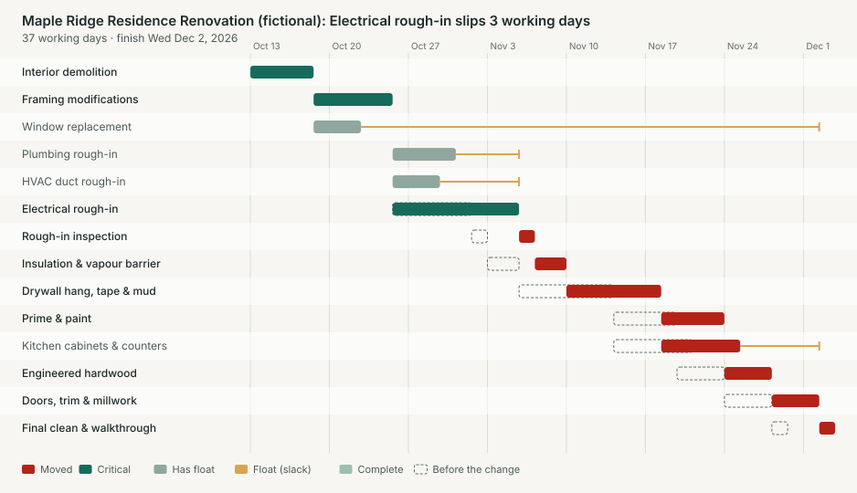
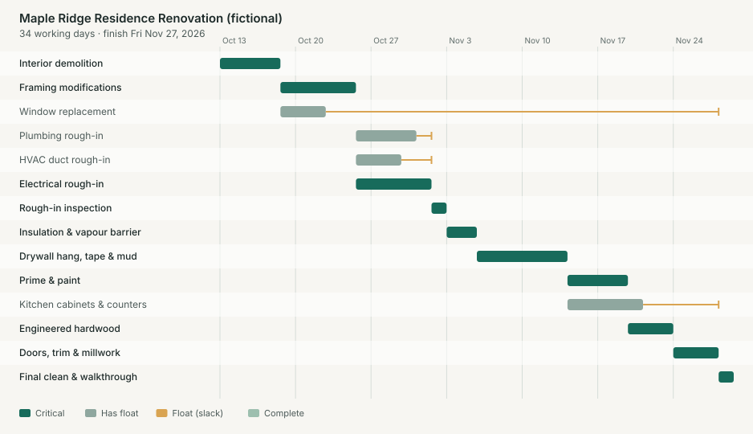
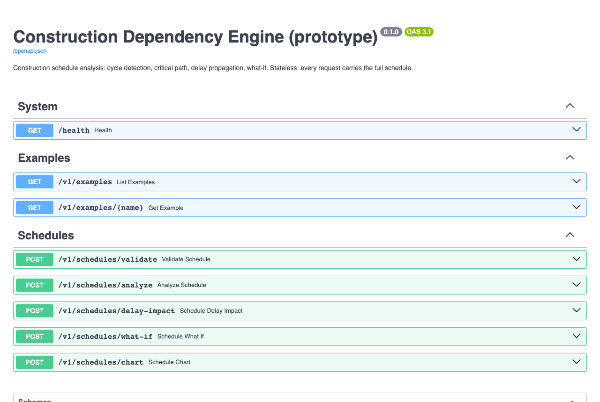

# construction-dependency-engine

A deterministic scheduling service for construction projects. It finds circular dependencies, computes the critical path on a working-day calendar, and explains in plain English what a delay does to downstream work and the completion date.

> **Open-source prototype.** Built as an engineering demonstration. It is not deployed, and
> every schedule in it is fictional. No LLM is involved: every number comes from graph
> algorithms that are tested against hand-computed answers and an independent library.



```text
'Electrical rough-in' slips 3 working days. It is on the critical path (0 days of float), so every
working day of delay passes straight through. 8 of 8 downstream tasks start later: 'Rough-in
inspection' (+3), 'Insulation & vapour barrier' (+3), 'Drywall hang, tape & mud' (+3), ...
Projected completion moves from Fri Nov 27, 2026 to Wed Dec 2, 2026 (+3 working days).
```

## Quick start

```bash
uv venv && uv pip install -e ".[dev]"
python -m dependency_engine.demo                 # 7 scenarios in the terminal
uvicorn dependency_engine.api:app --reload       # API docs at http://localhost:8000/docs
```

## The problem

On a renovation, "electrical slipped three days" can mean nothing at all or a week's delay to
handover. It depends on what waits on the electrical work and how much slack those tasks have.
Superintendents usually work this out in their heads. This service does it explicitly:
which tasks move, by how much, whether completion moves, and why.

## What it does

| Capability | Implementation |
|---|---|
| Tasks as a directed graph with finish-to-start prerequisites | `models.py`, `graph.py` |
| Validation: duplicate ids, unknown or self dependencies, cycles | `graph.structural_issues`, `graph.find_cycle` |
| Circular-dependency detection that returns the actual loop, in words | three-colour DFS, `cpm.cycle_issue` |
| Earliest and latest start and finish, total and free float | forward and backward pass, `cpm.analyze` |
| Critical path | `cpm.critical_path` |
| Working-day calendar with configurable work week and holidays | `calendar.py` |
| Projection from progress (`as_of`, status, percent complete) | `cpm.remaining_duration` |
| Delay propagation: affected downstream tasks, float absorbed, completion change | `impact.delay_impact` |
| What-if: recompute completion with new durations | `impact.what_if` |
| Plain-English explanations of delays, float and conflicts | `impact.explain_delay` |
| SVG schedule chart (critical tasks, float, before/after a delay) | `render.py`, `POST /v1/schedules/chart` |
| Documented REST API (OpenAPI at `/docs`) | `api.py` |

## Algorithms

```mermaid
%%{init: {'theme':'base','themeVariables':{'primaryColor':'#E3E9E5','primaryTextColor':'#1C2928','primaryBorderColor':'#176B5B','lineColor':'#176B5B','secondaryColor':'#F7F6F2','tertiaryColor':'#FFFFFF','fontFamily':'Inter, system-ui, sans-serif'}}}%%
flowchart LR
    IN["ScheduleContract v1<br/>(JSON)"] --> V["Validate<br/>ids, references"]
    V --> C["Cycle check<br/>3-colour DFS · O(V+E)"]
    C -->|cycle| E["422 + the loop in words"]
    C -->|acyclic| T["Topological order<br/>Kahn + min-heap · O((V+E) log V)"]
    T --> F["Forward pass<br/>ES = max EF(pred)"]
    F --> B["Backward pass<br/>LF = min LS(succ)"]
    B --> FL["Float + critical path"]
    FL --> CAL["Working-day offsets → dates<br/>weekends + holidays"]
    CAL --> OUT["Schedule result"]
    OUT -. "change one task,<br/>recompute, diff" .-> IMP["Delay impact / what-if<br/>+ explanation"]
```



- **Cycle detection** walks "waits on" edges with an iterative three-colour DFS. Reaching a node already on the current path means a loop, and that slice of the path *is* the cycle, so the error names it: *"'Electrical rough-in', which waits on 'Drywall', which waits on 'Insulation', which waits on 'Electrical rough-in'."*
- **Topological order** uses Kahn's algorithm. Ties go to input order (via a min-heap), so identical input always gives identical output.
- **CPM** runs in integer working-day offsets. Dates are only produced at the end, so the graph code never deals with weekends. [docs/WORKED_EXAMPLE.md](docs/WORKED_EXAMPLE.md) works the forward pass, backward pass and both kinds of float by hand for a six-task example.
  - Forward pass: `ES = max(EF of predecessors)`, `EF = ES + duration`.
  - Backward pass: `LF = min(LS of successors)`, `LS = LF − duration`.
  - Total float is `LS − ES`; free float is `min(ES of successors) − EF`.
- **Delay impact** recomputes from scratch and diffs the two results. CPM is O(V + E), so this is simpler and safer than updating dates incrementally, and fast for thousands of tasks.

## Scheduling assumptions

These are returned in every `analyze` response, so a reader can't miss them:

1. Durations are **whole working days**. The default week is Monday to Friday; `calendar.workdays` and `calendar.holidays` change it.
2. Dependencies are **finish-to-start with no lag**. A task starts the working day after its last predecessor finishes.
3. **Unlimited resources.** Tasks without a dependency between them can run at the same time; there is no resource levelling, and crews aren't modelled.
4. Tasks are scheduled **as early as possible**. `planned_start` in the input is informational.
5. **Projected mode** (`as_of` set): complete tasks need no time; in-progress tasks need `ceil(duration × (1 − percent/100))` days starting from `as_of`; no remaining work starts before `as_of`.
6. `delay_days` is added to a task's remaining duration.
7. Results over 10,000 working days are rejected as input errors.

## Correctness

| Evidence | Where |
|---|---|
| A six-activity textbook network checked by hand: every ES, EF, LS, LF, total float and free float, plus the path and finish date | `test_cpm.py` |
| A 14-task renovation with a holiday on the start date: duration 34, finish Fri Nov 27, floats for plumbing 1, HVAC 2, windows 26, cabinets 5 | `test_cpm.py` |
| Delay cases: critical (+3 → Wed Dec 2), absorbed by float (HVAC +2 → no change), partly absorbed (HVAC +3 → +1), large-float branch | `test_impact.py` |
| **300 random DAGs**: project length equals NetworkX's `dag_longest_path_length` | `test_against_networkx.py` |
| **200 random DAGs**: finish-to-start holds, floats are non-negative, free float ≤ total float, the reported critical path is a real chain whose durations add up to the project length | `test_against_networkx.py` |
| **300 random graphs with possible cycles**: our cycle detection agrees with `nx.is_directed_acyclic_graph`, and the topological order is valid | `test_against_networkx.py` |
| A real export from `construction-ops-platform`, unmodified, analysed with progress | `test_ops_contract.py` |

NetworkX is a **test-only** dependency, used as an independent reference. The engine itself uses only the standard library.

Writing these tests found one real bug: a zero-duration "end" milestone was dropped from the
critical path, because it ties with its predecessors on finish time. The path walk now starts
from the last task in topological order.

## Run it locally

```bash
uv venv && uv pip install -e ".[dev]"     # or: python -m venv .venv && pip install -e ".[dev]"
python -m dependency_engine.demo          # walks through 7 scenarios in the terminal
uvicorn dependency_engine.api:app --reload # API with docs at http://localhost:8000/docs
```

Docker: `docker build -t construction-dependency-engine . && docker run -p 8000:8000 construction-dependency-engine`

No environment variables or credentials are needed. The service is stateless: every request carries its schedule.

## Demo walkthrough

The baseline plan, rendered by `python -m dependency_engine.render residential_renovation docs/images/schedule.svg`:



`python -m dependency_engine.demo` prints these (real output, abridged):

```text
1. Baseline plan: Maple Ridge renovation (Oct 12 is a holiday, so work starts Tue Oct 13)
   Project: 34 working days, finishing Fri Nov 27, 2026
   Critical path: Interior demolition → Framing → Electrical rough-in → Rough-in inspection → Insulation
                  → Drywall → Prime & paint → Engineered hardwood → Doors, trim & millwork → Final walkthrough

3. HVAC rough-in slips 2 working days (it has float)
   'HVAC duct rough-in' slips 2 working days. It had 2 working days of float before this change. None of
   the 8 downstream tasks move, because the float absorbs the whole delay. Projected completion is
   unchanged at Fri Nov 27, 2026. With its float used up, 'HVAC duct rough-in' is now also critical:
   any further slip moves completion.

4. What if drywall takes 4 days instead of 6 (bigger crew)?
   With 'Drywall hang, tape & mud' 6→4 days, projected completion moves 2 working days earlier,
   from Fri Nov 27, 2026 to Wed Nov 25, 2026.

5. Projected from progress as of Mon Nov 2: electrical should be done but is only 60% complete
   Project: 36 working days, finishing Tue Dec 1, 2026

7. An invalid schedule
   Circular dependency: 'Electrical rough-in', which waits on 'Drywall', which waits on 'Insulation',
   which waits on 'Electrical rough-in'. None of these tasks can ever start. Remove one of these dependencies.
```

## API

| Method and path | Purpose |
|---|---|
| `GET /health` | Liveness |
| `GET /v1/examples`, `GET /v1/examples/{name}` | Fictional example schedules |
| `POST /v1/schedules/validate` | Always 200: `{valid, issues}` with plain-English messages |
| `POST /v1/schedules/analyze` | Dates, float, critical path, assumptions. 422 with issues if the schedule is invalid. |
| `POST /v1/schedules/delay-impact` | `{schedule, task_id, delay_days}` → affected tasks, float absorbed, finish change, explanation |
| `POST /v1/schedules/what-if` | `{schedule, duration_changes}` → new finish and changed tasks |
| `POST /v1/schedules/chart` | The analysed schedule as an SVG image |



```http
POST /v1/schedules/delay-impact
{"schedule": { …ScheduleContract v1… }, "task_id": "electrical", "delay_days": 3}
```

```json
{
  "task_id": "electrical",
  "delay_days": 3,
  "task_float_before": 0,
  "absorbed_by_float": 0,
  "downstream_tasks": 8,
  "affected": [{"id": "inspection", "name": "Rough-in inspection", "start_shift_days": 3, "old_start": "2026-11-02", "new_start": "2026-11-05", "float_before": 0, "float_after": 0}, "…"],
  "finish_before": "2026-11-27",
  "finish_after": "2026-12-02",
  "finish_shift_days": 3,
  "explanation": "'Electrical rough-in' slips 3 working days. It is on the critical path …"
}
```

An invalid schedule:

```json
422 {"error": "invalid_schedule", "issues": [{"type": "cycle", "message": "Circular dependency: …", "task_ids": ["electrical", "drywall", "insulation"]}]}
```

## Integration with construction-ops-platform

`examples/ops_export_maple_ridge.json` is the Ops app's schedule export, produced by its own
`exportSchedule()` from its seed data and committed unmodified. The engine reads it as-is:

| Question | Answer from the engine |
|---|---|
| Finish if everything goes to plan | Thu Nov 26, 2026 |
| Finish projected from progress on Oct 31 (electrical 60% done and behind) | **Tue Dec 1, 2026** |
| Finish if electrical slips 2 more days | Thu Dec 3, 2026 |

`test_ops_contract.py` pins these values, so a change to the contract on either side fails CI.
See [docs/INTEGRATION.md](docs/INTEGRATION.md).

## Tests

```bash
pytest                                  # 44 tests, including 800 randomized graph checks
ruff check . && ruff format --check .
pip-audit --skip-editable
```

**Last local run: 44 passed** (macOS, Python 3.13, 31 Oct 2026). CI runs the same suite on
Python 3.12, runs the demo end to end, audits dependencies, and builds the Docker image.

## Security considerations

- Stateless, with no persistence, authentication or secrets. Put it behind the calling application's auth if deployed.
- **Bounded work per request.** At most 2,000 tasks, durations and delays of at most 1,000 days, and computed schedules over 10,000 working days rejected. Without that last limit, the largest valid input overflowed Python's date range and returned a 500 error; a test now covers it.
- Unknown fields in schedules are ignored, for forward compatibility. Request bodies for `delay-impact` and `what-if` reject unknown top-level fields.
- Task names are user input, so the SVG renderer XML-escapes all text (tested with a `<script>` task name). The chart response sets `nosniff`.
- Dependencies resolve only to releases published before a fixed date (`[tool.uv] exclude-newer`) as a supply-chain precaution. `pip-audit` reports no known vulnerabilities and runs in CI.

## Engineering trade-offs

- **Hand-written algorithms with NetworkX as the oracle**, rather than NetworkX at runtime. The code is short and explainable, and the randomized comparison gives independent evidence that it's correct.
- **Recompute and diff instead of incremental updates.** Easier to prove correct; fast enough at construction scale.
- **Offsets, not dates, inside the algorithms.** All calendar logic lives in one class, so the graph code never has to handle weekends.
- **Infinite-resource CPM.** Standard and explainable, but it ignores the fact that one electrician can't be on two floors at once. That's the biggest modelling gap.
- **Deterministic tie-breaking.** When two paths are equally critical, the earlier-listed task is reported. A newly tied path is described as "now also critical" rather than as a change of path.

## Known limitations

- Finish-to-start only: no start-to-start, finish-to-finish or lags.
- No resource levelling or crew calendars.
- Only one critical path is reported; tied paths show up through each task's `critical` flag.
- A projected `as_of` date uses percent complete as reported, with no check on whether it's realistic.
- Milestones at the very end of a project display the next working day as their date.

## Future improvements

1. Lags and start-to-start links (common for drywall following electrical floor by floor).
2. Resource-constrained scheduling for crews shared across tasks.
3. Return all critical paths, not one representative.
4. Monte Carlo duration ranges for the probability of hitting a target date.
5. Feed float and impact explanations back into `construction-ops-platform` blockers.

## License

MIT. See [LICENSE](LICENSE).
