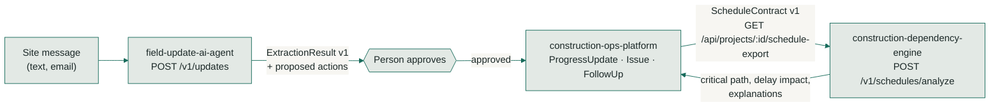

# Shared data contracts

The three repositories are independent. Each one installs, runs and tests on its own.
They share a small vocabulary and two JSON contracts, so they can be connected. This file is
identical in all three repositories.

| Repository | Role |
|---|---|
| `construction-ops-platform` | System of record (Next.js, PostgreSQL): projects, subcontractors, tasks, progress, issues, follow-ups |
| `field-update-ai-agent` | Turns unstructured site messages into validated structured data and *proposed* actions |
| `construction-dependency-engine` | Deterministic schedule maths: cycle detection, critical path, delay propagation |



## Status of each link

| Link | Status |
|---|---|
| Ops → Engine (ScheduleContract v1) | **Working and tested.** The engine's fixture `examples/ops_export_maple_ridge.json` was produced by the Ops app's own `exportSchedule()` from its seed data, unmodified. A contract test in the engine checks the projected finish date. |
| Agent → Ops (ExtractionResult v1) | **Contract only.** The agent validates and stores it. Ops reserves `source = "ai_agent"` on progress updates. No automated import exists: a person would carry approved actions across today. |
| Engine → Ops | **Not built.** The engine's explanations are designed to sit next to Ops blockers. |

## Shared enums

**Trade:** `general`, `demolition`, `concrete`, `framing`, `roofing`, `plumbing`, `electrical`,
`hvac`, `insulation`, `drywall`, `painting`, `flooring`, `finish_carpentry`, `other`

**Task status:** `not_started`, `in_progress`, `blocked`, `complete`. The engine also accepts `delayed`.

Ops stores these as uppercase PostgreSQL enums (`ELECTRICAL`) and lowercases them at the boundary.

## ScheduleContract v1 (Ops → Engine)

```json
{
  "contract_version": "1.0",
  "project_id": "prj_maple_ridge",
  "project_name": "Maple Ridge Residence Renovation",
  "start_date": "2026-10-12",
  "as_of": "2026-10-31",
  "tasks": [
    {
      "id": "cmvw…",
      "name": "Electrical rough-in",
      "trade": "electrical",
      "duration_days": 5,
      "status": "in_progress",
      "percent_complete": 60,
      "planned_start": "2026-10-23",
      "depends_on": ["cmvw…"]
    }
  ]
}
```

- `duration_days` are **working days** (Monday to Friday unless a `calendar` object says otherwise).
- `depends_on` lists predecessors with **finish-to-start** semantics. Each item is a task id, or (contract 1.1) an object with a lag; see below.
- `as_of` is optional. When present, the engine projects remaining work from that date using status and percent complete.
- `planned_start` is informational. The engine schedules each task as early as its dependencies allow.
- Unknown fields are ignored, so either side can add fields without breaking the other.

### Contract 1.1: dependency lags

A `depends_on` item may be an object instead of a plain id:

```json
"depends_on": ["cmvw_electrical", {"id": "cmvw_drywall", "lag_days": 2}]
```

- `lag_days` is a whole number of **working days** from 0 to 365, on the same calendar as
  `duration_days`. With a lag of 2, the task can start two working days later than it otherwise
  could. It defaults to 0, so `{"id": "x"}` means the same as `"x"`.
- Plain ids still work, and both forms can be mixed in one list. Every 1.0 payload is a valid
  1.1 payload with the same meaning.
- Unlike the rest of the contract, a dependency object may not contain unknown keys. A key such
  as a relationship type would change what the dependency means, so ignoring it would be wrong;
  the request is rejected with a validation error.
- If the same predecessor appears more than once, the largest lag applies (each entry is a
  constraint, and the largest is the one that binds).
- `contract_version` stays informational: the engine reads both forms whatever it says.
- **Engine support:** lags are accepted and validated, but the scheduling passes don't apply
  them yet. A schedule with any non-zero lag is refused with `422` and an issue of type
  `lag_not_supported`, so a lag is never silently ignored. Zero lags schedule normally.
- When the engine writes a schedule back (for example `GET /v1/examples/{name}`), zero-lag links
  are plain ids and the rest are objects.

## ExtractionResult v1 (Agent → Ops)

The full JSON Schema is served by the agent at `GET /v1/schema/extraction`.

```json
{
  "project_ref": null,
  "trade": "electrical",
  "location": "second floor",
  "work_status": "in_progress",
  "delay": { "reported": true, "estimated_days": null, "reason": "electrician couldn't finish" },
  "schedule_impact": { "blocks_downstream": true, "affected_activities": ["drywall"], "severity": "medium" },
  "blocker": { "is_blocker": true, "category": "predecessor_incomplete", "description": "Drywall waits on electrical" },
  "relevant_dates": [{ "text": "Thursday", "date": "2026-11-05", "refers_to": "drywall start" }],
  "follow_up_questions": ["Does the electrician need another day on the second floor?"],
  "missing_information": ["project", "delay duration"],
  "confidence": { "overall": 0.7, "low_confidence_fields": [] },
  "assumptions": []
}
```

How it maps onto Ops:

| ExtractionResult | Ops record | Notes |
|---|---|---|
| `work_status` + a note | `ProgressUpdate` with `source = "ai_agent"` | Needs a task match first |
| `blocker.is_blocker = true` | `Issue` with `isBlocker = true` | Severity from `schedule_impact.severity` |
| `follow_up_questions` and conflict warnings | `FollowUp` in `PENDING_APPROVAL` | Ops already requires an owner to approve |
| `delay.estimated_days` | Engine `POST /v1/schedules/delay-impact` | Shows which tasks and dates move |

Nothing in any repository sends a message to a subcontractor. Every outbound message or
schedule change needs a person to approve it.
