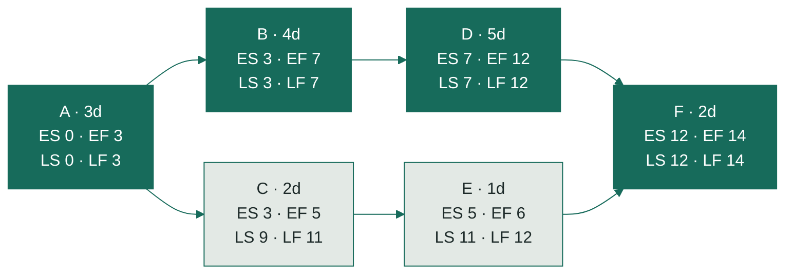

# Worked example: CPM by hand

This walks through the six-task example in [`textbook_cpm.json`](../src/dependency_engine/examples/textbook_cpm.json) the way you would on paper, then checks every number against the engine and the test `test_textbook_example_forward_backward_and_float` in [`tests/test_cpm.py`](../tests/test_cpm.py).

## The network

Dark boxes are the critical path. All numbers are working-day offsets from the project start, and finishes are exclusive: a 3-day task starting at day 0 has EF 3 and occupies days 0, 1 and 2. That's the convention in [`cpm.py`](../src/dependency_engine/cpm.py).

## Forward pass: how early can each task happen?

A task starts when its last predecessor finishes: **ES = max EF of predecessors** (0 if none), and **EF = ES + duration**.

| Task | Predecessors | ES | EF |
|---|---|---|---|
| A | none | 0 | 0 + 3 = **3** |
| B | A (3) | 3 | 3 + 4 = **7** |
| C | A (3) | 3 | 3 + 2 = **5** |
| D | B (7) | 7 | 7 + 5 = **12** |
| E | C (5) | 5 | 5 + 1 = **6** |
| F | D (12), E (6) | max(12, 6) = 12 | 12 + 2 = **14** |

The project takes **14 working days**: the largest EF.

## Backward pass: how late can each task happen?

Start at the end and work back. A task must finish before its earliest successor has to start: **LF = min LS of successors** (the project end, 14, if none), and **LS = LF − duration**.

| Task | Successors | LF | LS |
|---|---|---|---|
| F | none | 14 | 14 − 2 = **12** |
| D | F (12) | 12 | 12 − 5 = **7** |
| E | F (12) | 12 | 12 − 1 = **11** |
| B | D (7) | 7 | 7 − 4 = **3** |
| C | E (11) | 11 | 11 − 2 = **9** |
| A | B (3), C (9) | min(3, 9) = 3 | 3 − 3 = **0** |

## Float and the critical path

- **Total float = LS − ES.** How many days a task can slip before the *project end* moves.
- **Free float = min ES of successors − EF.** How many days a task can slip before *any other task* has to move. For a task with no successors, the project end (14) stands in for the successor.

| Task | ES | EF | LS | LF | Total float | Free float | Critical |
|---|---|---|---|---|---|---|---|
| A | 0 | 3 | 0 | 3 | 0 | min(3, 3) − 3 = 0 | yes |
| B | 3 | 7 | 3 | 7 | 0 | 7 − 7 = 0 | yes |
| C | 3 | 5 | 9 | 11 | **6** | 5 − 5 = **0** | no |
| D | 7 | 12 | 7 | 12 | 0 | 12 − 12 = 0 | yes |
| E | 5 | 6 | 11 | 12 | **6** | 12 − 6 = **6** | no |
| F | 12 | 14 | 12 | 14 | 0 | 14 − 14 = 0 | yes |

The critical path is every task with zero total float: **A → B → D → F** (3 + 4 + 5 + 2 = 14 days).

### Total float vs free float, using C and E

C and E both have **6 days of total float**, but they share it.

- **E** has **6 days of free float.** It can slip up to 6 days and nothing else moves. Its only successor, F, can't start before day 12 anyway because of D.
- **C** has **0 free float.** If C slips even 1 day, E has to start a day later. The project end doesn't move until C slips more than 6 days, but every day C uses comes out of E's float.

So the C → E chain has 6 spare days in total, not 12. If a foreman says "C has 6 days of float" and E's foreman says the same, both are right, but they can't both use it. This is why the engine reports both numbers.

## Calendar dates

The project starts Monday, Nov 2, 2026. Weekends are skipped, and this window has no holidays. Day 0 is Nov 2 and day 13 (the last day of F) is **Thursday, Nov 19**.

| Task | Early start | Early finish |
|---|---|---|
| A | Mon Nov 2 | Wed Nov 4 |
| B | Thu Nov 5 | Tue Nov 10 |
| C | Thu Nov 5 | Fri Nov 6 |
| D | Wed Nov 11 | Tue Nov 17 |
| E | Mon Nov 9 | Mon Nov 9 |
| F | Wed Nov 18 | Thu Nov 19 |

## Checked against the engine

Every number above was worked by hand and then compared with:

- `analyze(load_example("textbook_cpm"))`: the same ES, EF, LS, LF, total float, free float and dates for all six tasks; duration 14; critical path `['A', 'B', 'D', 'F']`; projected finish 2026-11-19.
- `test_textbook_example_forward_backward_and_float`, which asserts the same table and passes.

There were no differences to resolve.
